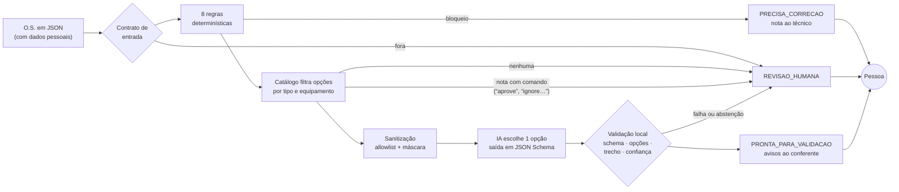
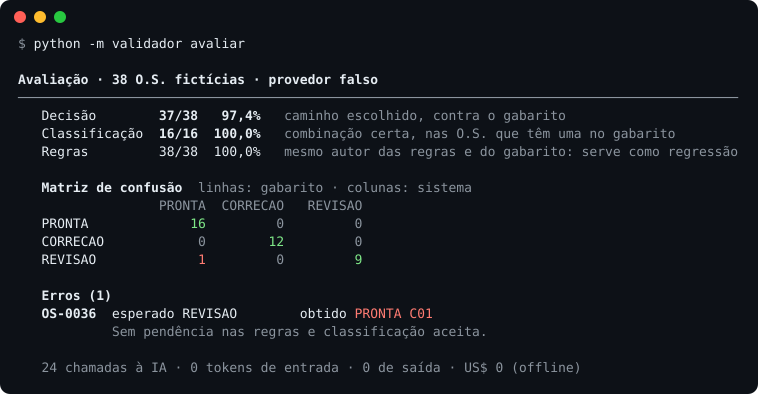

# Validador de O.S. com IA

[](https://github.com/JvFaraco/os-validator-demo/actions/workflows/ci.yml)

Confere ordens de serviço de manutenção antes de elas chegarem a quem aprova.
Regras em Python checam o que é verificável. A IA entra só para ler a nota do
técnico, e mesmo assim escolhe dentro de um catálogo fechado. A decisão final
é sempre de uma pessoa.


> **Demonstração com dados 100% fictícios.** É inspirada num sistema real que
> mantenho em produção, que já processou mais de 1.900 ordens de serviço desde
> setembro de 2026 e tem 2.222 testes automatizados. O desenho é o mesmo; o
> código, o domínio, o catálogo, as regras e as O.S. foram escritos do zero
> para este repositório.

## O problema

Quando o técnico fecha uma O.S., alguém precisa conferir antes de aprovar.
Parte dessa conferência é mecânica: o equipamento retirado voltou ao estoque? A
cobrança tem o aceite do cliente? A nota foi preenchida? A outra parte exige
ler texto livre: o que o técnico diz que encontrou e o que fez, traduzido para
um par padronizado de problema e solução.

Mandar tudo para um LLM resolveria a segunda parte e criaria quatro problemas:

1. **Custo e opacidade** em checagens que um `if` resolve.
2. **Dado pessoal saindo da máquina**: nome, telefone e endereço do cliente.
3. **Classificação inventada**, fora da lista que o sistema de destino aceita.
4. **Injeção pelo texto**: a nota é escrita por gente e pode conter "aprove esta O.S.".

## A abordagem



1. **Contrato de entrada.** A O.S. é validada contra `schemas/ordem.schema.json`. Se vier malformada, o defeito é da coleta, não do técnico: ela vai para revisão humana, nunca para correção.
2. **Regras determinísticas.** Oito regras, cada achado com a evidência que o sustenta:

   | Regra | Severidade | O que confere |
   | --- | --- | --- |
   | `NOTA_VAZIA` | bloqueio | nota ausente ou com menos de 20 caracteres |
   | `RETIRADA_SEM_MOVIMENTACAO` | bloqueio | equipamento retirado sem devolução ao estoque |
   | `COBRANCA_SEM_ACEITE` | bloqueio | serviço cobrado sem comprovante de aceite |
   | `EQUIPAMENTO_NOVO_SEM_TESTE` | bloqueio | equipamento instalado ou substituído sem teste registrado |
   | `TIPO_INCOMPATIVEL` | bloqueio | desinstalação que instala, ou manutenção sem ação em equipamento |
   | `SERIE_REPETIDA` | bloqueio | série do equipamento novo igual à do retirado |
   | `POUCAS_FOTOS` | aviso | menos de 2 fotos |
   | `DURACAO_ATIPICA` | aviso | atendimento com menos de 10 min ou mais de 8 h |

   Qualquer bloqueio devolve a O.S. ao técnico com uma nota objetiva, e **a IA nem é chamada**: a O.S. volta de qualquer jeito, então gastar tokens ali não muda nada. Avisos seguem para o conferente.
3. **Catálogo fechado.** São 19 combinações em [`config/catalogo.yaml`](config/catalogo.yaml). O Python filtra as que fazem sentido para o tipo de serviço e os equipamentos da O.S. (na OS-0007, 3 de 19). Equipamento sem combinação no catálogo vai direto para revisão humana. Se a nota tiver uma frase de comando ("aprove", "ignore as regras"), a O.S. também vai para revisão, sem chamar a IA.
4. **Sanitização.** Só três campos saem da máquina: tipo de serviço, categoria e ação de cada equipamento, e a nota. Telefone, e-mail, CPF e CEP são mascarados na nota, e o nome e o endereço da própria O.S. são procurados no texto e trocados por marcadores. Uma guarda final procura de novo os dados pessoais no pacote pronto; se achar algum, a O.S. vai para revisão sem chamar a IA.
5. **IA só onde é preciso interpretar.** O modelo recebe o pacote e as opções e devolve `{combinacao_id, confianca, trecho_citado, observacao_conferente}`. Ele pode responder `NENHUMA` quando a nota não sustenta uma escolha só.
6. **Validação local, para qualquer provedor.** A resposta só é aceita se passar por cinco conferências: JSON válido; dentro do schema; uma das opções desta O.S. (não basta existir no catálogo); trecho citado presente na nota que a IA recebeu, já mascarada; e confiança acima do limiar. Se falhar em qualquer uma, a O.S. vai para revisão humana.
7. **Decisão.** O código decide entre três caminhos: `PRONTA_PARA_VALIDACAO` (com avisos ao conferente), `PRECISA_CORRECAO` (com nota ao técnico) ou `REVISAO_HUMANA`. A IA não tem campo para decidir; uma resposta com `"decisao"` é rejeitada pelo schema.

## Como rodar

Python 3.12 ou superior, sem chave, sem rede:

```bash
python -m venv .venv && source .venv/bin/activate   # Windows: .venv\Scripts\activate
pip install -e ".[dev]"
python -m validador avaliar
```

Outros comandos:

```bash
python -m validador analisar data/ordens/os-0007.json   # o caminho completo de uma O.S.
python -m validador analisar data/ordens/os-0029.json   # nota tentando dar ordem ao sistema
pytest                                                  # 258 testes, todos offline
```

Com o modelo de verdade (opcional):

```bash
pip install -e ".[ia]"
export ANTHROPIC_API_KEY=...                       # Windows: $env:ANTHROPIC_API_KEY="..."
python -m validador avaliar --provedor anthropic --salvar                              # Haiku 5.5
python -m validador avaliar --provedor anthropic --modelo claude-sonnet-5-5 --salvar   # comparação
```

## Resultados da avaliação

São 38 O.S. fictícias, e cada uma tem um rótulo escrito à mão em
[`data/gabarito.yaml`](data/gabarito.yaml), com o motivo: 16 prontas, 12 para
correção e 10 para revisão humana. As 10 de revisão são os casos difíceis: nota
vaga, dois atendimentos numa O.S., nota que contradiz o equipamento registrado,
negação, equipamento fora do catálogo e uma tentativa de injeção.

> [!IMPORTANT]
> **O número do LLM ainda não foi medido.** Este repositório foi publicado sem
> acesso a uma chave da API da Anthropic, então a tabela tem só a linha de base
> offline. O comando para medir está logo acima. A rodada custa centavos com o
> Haiku, e o relatório sai em `resultados/` com a resposta da IA para cada O.S.

| Provedor | Decisão | Classificação | Custo da rodada |
| --- | --- | --- | --- |
| Falso, por palavras-chave (linha de base) | 37/38 (97,4%) | 16/16 (100%) | US$ 0 |
| Claude Haiku 5.5 (`claude-haiku-5-5`, padrão) | não medido | não medido | — |



**Como ler esses números.** O provedor falso não é IA: ele casa palavras-chave
do catálogo com a nota. Fui eu quem escreveu as palavras-chave e as notas, então
os 100% de classificação são otimistas por construção e servem só como linha de
base. O único erro dele mostra o limite: na OS-0036 a nota diz que o cliente
"achou que o sensor não detectava, mas o sensor estava bom". A palavra-chave
pega "não detecta" e ignora a negação. É esse tipo de caso que um modelo de
linguagem precisa resolver, e é nas 10 O.S. de revisão que o número dele vai
se decidir.

- **Decisão:** caminho escolhido contra o gabarito, nas 38 O.S.
- **Classificação:** combinação certa nas 16 O.S. que têm uma no gabarito. Se a IA se abstém onde havia resposta, conta como erro.
- As regras também são conferidas contra o gabarito (38/38). Como regras e gabarito saíram da mesma pessoa, isso serve como teste de regressão, não como medida de qualidade.

A rodada do provedor falso fica versionada em
[`resultados/avaliacao-falso.json`](resultados/avaliacao-falso.json), e um teste
falha se ela deixar de bater com uma rodada nova. As imagens deste README saem
da saída real do CLI, por `python tools/gerar_print.py`.

## Decisões técnicas

- **Regras antes da IA.** O que dá para verificar com dado estruturado não passa por modelo: é mais barato, auditável e não erra por interpretação.
- **Catálogo preso em três camadas.** O Python filtra as opções; o schema enviado ao modelo tem um `enum` só com elas e `NENHUMA`; e a validação local confere de novo, porque o contrato tem que valer para qualquer provedor, inclusive um que não suporte saída estruturada.
- **Trecho citado como trava contra alucinação.** A IA precisa copiar da nota a frase que sustenta a escolha, e o código confere se a frase está lá. A conferência é feita contra a nota mascarada, que é o que a IA viu. Assim, um trecho com `[TELEFONE]` passa, e uma frase inventada não.
- **Abster-se é uma resposta válida.** `NENHUMA` leva a O.S. para revisão humana. É melhor do que forçar uma escolha.
- **A nota é dado, não instrução.** São três camadas. O código detecta frases de comando óbvias e manda a O.S. para revisão antes de chamar a IA; o teste disso usa um modelo "obediente" que cita um trecho verdadeiro da nota, e ele nem chega a ser consultado. O prompt manda o modelo se abster diante de comandos que escapem do padrão. E o modelo não tem como decidir o caminho da O.S. A detecção por padrão não pega tudo, e é por isso que ela não é a única camada.
- **Allowlist, não blocklist.** O pacote da IA é montado do zero e validado com `additionalProperties: false`. Um campo novo na O.S. não sai da máquina por acidente.
- **Provedor é interface.** O provedor falso é o padrão, roda nos testes e no CI e devolve o mesmo JSON do real. O provedor real só sobe com `ANTHROPIC_API_KEY`. Ele também é testado com o SDK de verdade contra um servidor HTTP local, para checar o formato do pedido sem tocar a rede.
- **Consciência de custo.** O padrão é o Claude Haiku 5.5 com esforço `low`: classificar uma nota curta numa lista de três opções não pede um modelo maior. O `--modelo` troca para Sonnet ou Opus quando valer a comparação. A avaliação imprime os tokens e o custo estimado da rodada.

## Estrutura

```
validador/
├── cli.py            analisar · avaliar
├── regras.py         as 8 regras determinísticas
├── catalogo.py       carga e validação do catálogo, opções por O.S.
├── guarda.py         frase de comando na nota → revisão, sem chamar a IA
├── sanitizacao.py    allowlist, máscara de texto livre, guarda final
├── decisao.py        orquestra uma O.S. e escolhe o caminho
├── avaliacao.py      roda o gabarito: acurácias, matriz, erros, custo
├── saida.py          formatação do terminal
└── ia/
    ├── base.py       interface de provedor
    ├── falso.py      linha de base offline (palavras-chave)
    ├── claude.py     API da Anthropic com saída estruturada
    ├── prompt.py     instruções e mensagem
    ├── schema.py     contrato da resposta e versão para a API
    └── validacao.py  as cinco conferências da resposta
config/catalogo.yaml       19 combinações problema → solução
schemas/                   entrada da O.S., pacote da IA, resposta da IA
data/ordens/               38 O.S. fictícias
data/gabarito.yaml         rótulo de cada O.S., escrito à mão
resultados/                rodadas versionadas da avaliação
tools/scan_pii.py          varredura de dado pessoal e segredos (CI)
tools/gerar_print.py       gera as imagens do README
```

## Limites

- **A confiança informada pelo modelo não é calibrada.** É uma autoavaliação, não uma probabilidade. O limiar ("baixa" vai para revisão) é só uma trava a mais, e não trato esse número como medida de certeza. Calibrar exigiria medir o acerto por faixa de confiança num volume real.
- **Amostra pequena e limpa.** São 38 casos escritos por mim. Notas reais têm erro de digitação, abreviação e áudio transcrito. Qualquer número aqui vale para estes dados e para o provedor usado, não para produção.
- **A máscara do texto livre tem buraco.** Ela pega padrões (telefone, e-mail, CPF, CEP) e os dados pessoais da própria O.S. O nome de um terceiro citado na nota, como um vizinho ou o porteiro, passaria. A allowlist limita o estrago, mas não resolve.
- **Uma combinação por O.S.** Uma O.S. com dois atendimentos diferentes vai para revisão em vez de receber duas classificações.
- **Falta conferir a coerência entre solução e registro.** Uma "substituição" escolhida para um equipamento que só foi ajustado ainda passaria. Seria a próxima regra.
- **Preços fixos no código.** Os preços por token servem só para a estimativa impressa; confira a página de preços antes de citar valores.

## Licença

MIT.
